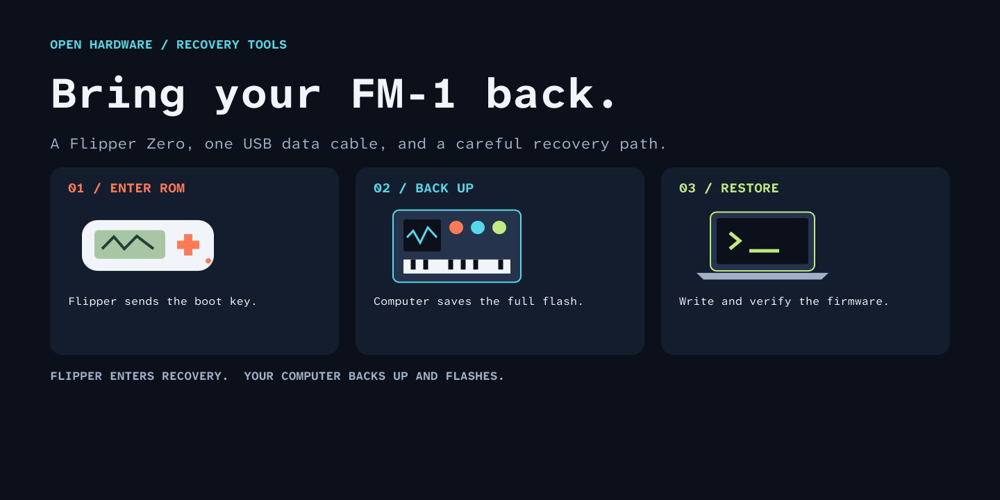
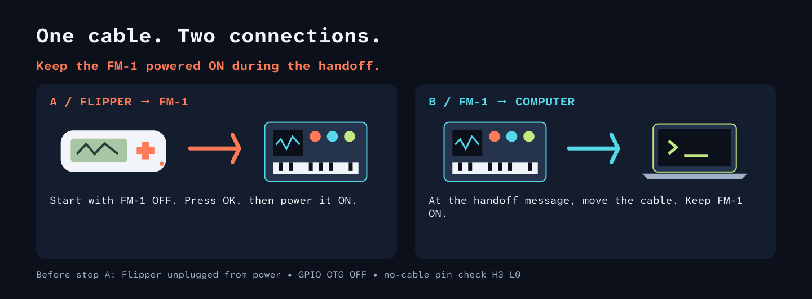

# FM1 Recovery for Flipper Zero



Recover an **M-VAVE FM-1** that no longer starts or appears as a USB MIDI device.
The Flipper sends the ROM boot key through a normal USB data cable. A computer
then backs up the flash and installs working firmware.

**The Flipper app enters recovery; it does not write FM-1 firmware.**
No GPIO wiring or additional USB host board is needed.

This is a documented distribution of
[merthsoft/flipper-fm1-recovery](https://github.com/merthsoft/flipper-fm1-recovery),
with Figma-designed instructions, a macOS recovery guide, and build/test automation.
The original recovery implementation is credited to that project; its source is
retained under the Unlicense. See [provenance](THIRD-PARTY.md).

## What you need

- Flipper Zero with an SD card and a matching app build.
- A charged FM-1 and a **USB data cable** connecting its USB-C port to the Flipper's USB-C port.
- A Mac or Windows computer, plus a compatible FM-1 `.fwsc` package from its author.
- On macOS: [M-Flasher](https://github.com/jvitkauskas/m-flasher/releases).
- On Windows: the included backup and restore scripts and their documented dependencies.

The included app source was built for **Momentum mntm-012, target F7, API 87.1**.
That configuration and a Mac recovery to SLOOP 2.8 were exercised on hardware.
Other Flipper firmware versions require their own matching SDK/build; do not
assume a FAP for one API major works on another.

## Install the Flipper app

Build it using the instructions below, or use a matching release asset if available.
With **qFlipper**, copy `fm1_boot_key.fap` to:

```text
/ext/apps/Tools/fm1_boot_key.fap
```

On the Flipper, open **Apps → Tools → FM1 Recovery**. If necessary, use the file
browser: **SD Card → apps → Tools → fm1_boot_key.fap**.

## Put the FM-1 into ROM recovery



1. Disconnect the Flipper from the computer and chargers. Disable GPIO OTG power.
   Both devices must run on their batteries during the boot-key step.
2. Open **FM1 Recovery**. With **no USB cable attached**, press **Right**.
   The pin check must report **H3 L0**. Stop if it reports something else.
3. Switch the **FM-1 OFF**, then connect it directly to the Flipper using the data cable.
4. Press **OK** on the Flipper, then switch the **FM-1 ON**. **Back** cancels.
5. Wait for **“Move FM1 cable to PC now.”** Move the FM-1 connection to the computer
   **without turning the FM-1 off**.
6. Confirm the computer detects **WL82 UBOOT1.00**, USB `4C4A:8057`.
   A message on the Flipper alone is not proof of successful USB enumeration.

The ROM interface is different from normal USB MIDI. A browser's normal FM-1
installer cannot flash it until working firmware has been restored.

## Restore on macOS

Use the [Mac guide](docs/MACOS.md). It uses M-Flasher's Mac build for backup,
application-only installation, and readback verification. The included Python
SCSI scripts are **Windows-only**.

## Restore on Windows

Use the [Windows guide](docs/WINDOWS.md). The scripts require two identical full
backups, validate the model/chip/flash/key/package, and change only the application
area. Restoration defaults to an offline dry run.

## Build

Use an isolated environment:

```sh
python3 -m venv .venv
# macOS / Linux:
. .venv/bin/activate
# Windows PowerShell instead: .venv\Scripts\Activate.ps1
python -m pip install ufbt
ufbt update --hw-target=f7 --url=https://github.com/Next-Flip/Momentum-Firmware/releases/download/mntm-012/flipper-z-f7-sdk-mntm-012.zip
ufbt
```

Output: `dist/fm1_boot_key.fap`. Its import checks must pass for **target 7, API 87.1**.
Build against the SDK matching the firmware actually installed on your Flipper.
Installing this app does not replace the Flipper's operating firmware.

## Tests

```sh
python -m unittest discover -s tests -p '*_test.py'
cc -Wall -Wextra -Werror -fsanitize=undefined tests/flipper_trace_test.c -o trace-test
./trace-test
```

The tests cover package parsing, flash-boundary preservation, restore planning,
corruption rejection, trace timing wrap, and trace-buffer saturation. They do
not prove wire-level boot timing on every device or compatibility with every
custom firmware. The CI build checks the Momentum app imports too.

## Troubleshooting

| Result | Next step |
| --- | --- |
| `External USB power detected` | Disconnect the Flipper from computer/charger power and disable GPIO OTG. |
| Pin check is not `H3 L0` | Remove every USB cable. Do not continue until the no-cable check passes. |
| `No D+ response detected` | Cancel, confirm the FM-1 was off before starting, and check the data cable. |
| Handoff message, no ROM interface on computer | Check the computer's USB inventory; keep the FM-1 on during handoff. Do not treat the handoff message as a completed recovery. |
| Flash identity or package validation fails | Stop. Do not bypass the model, key, CRC or layout checks. |
| Restoration verified, screen remains blank | After the writer finishes, unplug USB, power off for five seconds, then boot normally without holding buttons. |

Application traces are stored locally on the Flipper in
`/ext/apps_data/fm1_boot_key/`. Review and redact diagnostics before sharing them.

## Preservation and privacy

Recovery tools must preserve the bootloader and device-specific data. Do not
select bootloader replacement, erase-all, or settings-wipe options for the Mac
application-only procedure. Keep backups private: they can contain calibration,
pairings, presets and other device-specific information.

This repository contains no device backups, firmware packages, hardware serials,
private traces, account credentials or personal filesystem paths. The examples use
placeholder drive paths. The Git history starts from a curated source snapshot.
Original public project links and legally required attribution remain.

The README graphics were created as editable layers in **Figma** and exported
as SVG. [Design source](docs/figma-design.js) recreates the graphics using the Figma
Plugin API. No Figma account identifiers or private file links are embedded.

## License and credits

Original recovery source: **merthsoft/flipper-fm1-recovery**,
revision `df88b86`, under the [Unlicense](LICENSE).
Documentation, Figma design source and exported graphics added here are also
released under the Unlicense. Flipper/Momentum SDKs, jl-uboot-tool, M-Flasher and
other external dependencies retain their own licenses; see [THIRD-PARTY.md](THIRD-PARTY.md).
This is an independent community tool, not an official M-VAVE or Flipper product.
